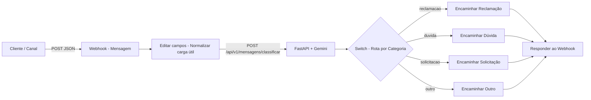

# Classificação e Encaminhamento Inteligente de Mensagens (FastAPI + n8n)


Solução de automação e inteligência artificial para triagem, classificação e roteamento de mensagens recebidas por múltiplos canais (WhatsApp, site, e-mail e outros). O projeto integra uma API em Python com FastAPI, conectada ao modelo Gemini para análise semântica, a um fluxo de orquestração local no n8n.

**Repositório oficial:** [github.com/tassianasc/kodie-classificacao-mensagens](https://github.com/tassianasc/kodie-classificacao-mensagens)

---

## Sumário

- [Arquitetura e Fluxo de Funcionamento](#arquitetura-e-fluxo-de-funcionamento)
- [Estrutura de Classificação](#estrutura-de-classificação)
- [Estrutura de Pastas](#estrutura-de-pastas)
- [Como Executar Localmente](#como-executar-localmente)
- [Como Testar o Fluxo](#como-testar-o-fluxo)
- [Evidências Visuais](#evidências-visuais)

---

## Arquitetura e Fluxo de Funcionamento



O processamento ocorre em etapas encadeadas:

1. **Entrada via Webhook (n8n):** o nó `Webhook - Mensagem` recebe requisições HTTP `POST` contendo `mensagem`, `remetente` e `canal`.
2. **Normalização de Dados (n8n):** o nó `Editar campos - Normalizar carga útil` padroniza os campos de entrada antes da chamada externa.
3. **Classificação Semântica (FastAPI + Gemini):** o nó `Solicitação HTTP - Classificar Mensagem` envia um `POST` para `http://127.0.0.1:8000/api/v1/mensagens/classificar`. A API analisa o texto via LLM (Gemini) e retorna:
   - `categoria`
   - `prioridade`
   - `setor_sugerido`
   - `resumo`
   - `intencao_detectada`
   - `confianca`
   - `requer_resposta_imediata`
   - `resposta_sugerida`
4. **Roteamento Condicional (n8n):** o nó `Switch - Rota por Categoria` direciona o item para uma das quatro saídas (`reclamacao`, `duvida`, `solicitacao` ou `outro`).
5. **Encaminhamento e Resposta (n8n):** nós dedicados (`Editar Campos - Encaminhar ...`) definem `fila_destino` e `acao_tomada`, e o nó `Responder ao Webhook` devolve o JSON consolidado ao solicitante.

---

## Estrutura de Classificação

| Campo | Valores Aceitos | Critério de Aplicação |
| :--- | :--- | :--- |
| **Categoria** | `duvida`, `reclamacao`, `solicitacao`, `outro` | Perguntas gerais (`duvida`), falhas ou insatisfação (`reclamacao`), pedidos de ação concreta (`solicitacao`), saudações ou mensagens sem enquadramento (`outro`). |
| **Prioridade** | `baixa`, `media`, `alta`, `urgente` | Risco crítico ou ameaça jurídica (`urgente`), falha relevante (`alta`), dúvida ou pedido padrão (`media`), agradecimento ou sem urgência (`baixa`). |
| **Setor Sugerido** | `suporte_tecnico`, `atendimento_cliente`, `financeiro`, `operacoes`, `qualidade` | Problemas técnicos (`suporte_tecnico`), cobranças e cancelamentos (`financeiro`), entregas e trocas (`operacoes`), reclamações gerais (`qualidade`), triagem geral (`atendimento_cliente`). |

---

## Estrutura de Pastas

```text
kodie-classificacao-mensagens/
├── app/
│   ├── main.py
│   ├── prompts.py
│   └── schemas.py
├── docs/
│   ├── fluxo-n8n.md
│   └── prints/
│       ├── Visão-geral.png
│       └── io-http-e-switch.png
├── n8n/
│   └── workflow-classificacao-mensagens.json
├── .env.example
├── .gitignore
├── requirements.txt
└── README.md
```

---

## Como Executar Localmente

### Pré-requisitos

- Python 3.11 ou superior
- Node.js e n8n instalados localmente
- Chave de API válida do [Google AI Studio](https://aistudio.google.com/) (Gemini)
- Cliente HTTP para testes (Insomnia, Postman ou cURL)

### 1. Configurar e iniciar a API FastAPI

No terminal, dentro da raiz do projeto:

**Windows (PowerShell)**

```powershell
python -m venv .venv
.venv\Scripts\Activate.ps1
pip install -r requirements.txt
```

**Linux / macOS**

```bash
python3 -m venv .venv
source .venv/bin/activate
pip install -r requirements.txt
```

Crie o arquivo `.env` a partir do `.env.example` e preencha sua chave em `GEMINI_API_KEY`:

```env
APP_ENV=development
APP_HOST=127.0.0.1
APP_PORT=8000
LOG_LEVEL=INFO

GEMINI_API_KEY=sua_chave_aqui
GEMINI_BASE_URL=https://generativelanguage.googleapis.com/v1beta/openai
GEMINI_MODEL=gemini-3.5-flash-lite
LLM_TIMEOUT_SECONDS=20
LLM_TEMPERATURE=0.1

API_CLASSIFICACAO_URL=http://127.0.0.1:8000/api/v1/mensagens/classificar
```

> [!IMPORTANT]
> O arquivo `.env` contém sua chave de API e não deve ser versionado. Confirme que ele está listado no `.gitignore`.

Inicie o servidor Uvicorn:

```powershell
python -m uvicorn app.main:app --reload --host 127.0.0.1 --port 8000
```

Verifique se a API está ativa:

| Recurso | URL |
| :--- | :--- |
| Health check | http://127.0.0.1:8000/health |
| Documentação interativa (Swagger) | http://127.0.0.1:8000/docs |

### 2. Iniciar o n8n e importar o fluxo

Em um segundo terminal, inicie o n8n:

```powershell
n8n start
```

1. Acesse http://localhost:5678 no navegador.
2. Crie um novo workflow e importe o arquivo `n8n/workflow-classificacao-mensagens.json`.
3. No nó `Solicitação HTTP - Classificar Mensagem`, confira se o método é `POST` e a URL está configurada para `http://127.0.0.1:8000/api/v1/mensagens/classificar`.
4. Salve o fluxo.

---

## Como Testar o Fluxo

1. No editor do n8n, clique em **Executar fluxo de trabalho** para colocar o webhook de teste em escuta (ou ative o workflow para usar a URL de produção).
2. No Insomnia (ou Postman), crie uma requisição `POST` para:

```text
http://localhost:5678/webhook-test/classificar-mensagem
```

Corpo da requisição (JSON):

```json
{
  "mensagem": "Não sei como usar essa plataforma. Há algum canal de ajuda? Um e-mail?",
  "remetente": "Maria",
  "canal": "whatsapp"
}
```

**Alternativa via cURL:**

```bash
curl -X POST http://localhost:5678/webhook-test/classificar-mensagem \
  -H "Content-Type: application/json" \
  -d '{"mensagem": "Não sei como usar essa plataforma. Há algum canal de ajuda? Um e-mail?", "remetente": "Maria", "canal": "whatsapp"}'
```

3. Clique em **Send**. O retorno esperado traz status `200 OK` e o payload roteado:

```json
{
  "fila_destino": "fila_suporte_tecnico",
  "acao_tomada": "encaminhado_para_atendimento_duvida",
  "id_processamento": "157de8af-0a25-418e-bf3d-58b45d3aea9e",
  "categoria": "duvida",
  "prioridade": "baixa",
  "resumo": "Cliente solicita canais de ajuda e suporte por não saber usar a plataforma.",
  "resposta_sugerida": "Olá Maria! Com certeza, podemos te ajudar. Você pode entrar em contato conosco pelo nosso e-mail de suporte ou acessar nossa central de ajuda online."
}
```

> [!NOTE]
> A URL `webhook-test` só responde enquanto o editor do n8n está em escuta. Com o workflow ativo, use `http://localhost:5678/webhook/classificar-mensagem`.

---

## Evidências Visuais

As capturas de tela em `docs/prints/` registram o fluxo e a troca de dados nas etapas.

### Visão geral do fluxo


### Entrada e saída na requisição HTTP e no Switch


